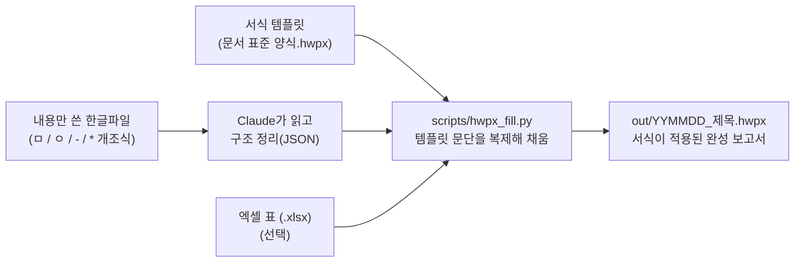

# project_hwpx — 한글(HWPX) 보고서 자동 채움 에이전트

> 내용만 적은 한글파일과 엑셀 표를 넣으면, 정해진 보고서 양식(HWPX)에 서식을 그대로 살려 채워 주는 Claude Code 스킬

신흥기술영향평가세미나 실습 과제로 만든 프로젝트입니다. "에이전트에게 일을 맡긴다"는 것이 실제 업무에서 어떻게 작동하고 어디서 막히는지, 내 업무의 불편 하나를 골라 직접 만들고 고쳐 보면서 기록했습니다.

### 45초 소개 영상


<sub>문제 → 입력 → 처리 흐름 → 결과 보고서 → 입력·출력 대응 → 사용법 순서로 반복 재생됩니다. 영상 생성 스크립트: [docs/make_demo.py](docs/make_demo.py)</sub>

---

## 1. 왜 만들었나 — 페인포인트

한글(HWPX) 양식 문서를 쓸 때마다 **붙여넣은 내용과 엑셀 표의 서식이 깨져서 손으로 다시 맞추는 일**이 반복됐습니다.

| 반복 작업 | 걸리던 시간(기준선) |
|---|---|
| Claude 답변을 한글 양식에 붙이고 개조식·글꼴(15pt 함초롱바탕 / 12pt 맑은고딕) 맞추기 | 최대 30분 |
| 엑셀 표를 붙인 뒤 열 너비·표 크기·글꼴 재정렬 | 최대 5분 |

**목표:** 내용을 넣으면 원하는 양식의 HWPX가 바로 만들어져서, **수동 수정 시간이 0분**이 되는 것.
**검증 기준:** 생성된 파일을 한글에서 직접 열어 손댈 곳이 하나도 없으면 통과.

자세한 내용: [01_페인포인트.md](01_페인포인트.md) · [02_기획안.md](02_기획안.md)

---

## 2. 무엇을 하나



입력 내용파일 예시와 결과:

실제 사용 예시 — [out/261008_기관장 현장소통 후보기업(기관) 조사 결과.hwpx](out/261008_기관장%20현장소통%20후보기업(기관)%20조사%20결과.hwpx)

| 입력 (서식 없이 자유롭게 쓴 내용 + 엑셀) | 출력 (템플릿 서식 그대로) |
|---|---|
| 기관장 현장소통 후보기업(기관) 조사 결과 | **제목 상자**: 기관장 현장소통 후보기업(기관) 조사 결과 |
| (날짜 없음) | 26.10.8.(목), 대외협력실 ← 생성일 자동 |
| 1. 개요 | **□ 추진 개요** |
| ㅇ 배경 : 정부 방침인 현장 중심의 정책이행 성과 창출 필요 | 　ㅇ (배경) 정부 방침인 현장 중심의 정책이행 성과 창출 필요 |
| \* 국정과제 000, 기관장 경영철학 제0호 | 　　\* 국정과제 000, 기관장 경영철학 제0호 ← `-` 단계 생략도 그대로 |
| ㅇ 목적 : 기관장 주도의 현장소통 기업(기관) 발굴 | 　ㅇ (목적) 기관장 주도의 현장소통 기업(기관) 발굴 |
| 2. 내용 | **□ 주요 내용** |
| ㅇ 조사기간 : ‘26. 10. 2. (금) ~ 10. 9.(금) | 　ㅇ (조사기간) '26. 10. 2.(금) ~ 10. 9.(금) |
| ㅇ 조사결과 : 4개 기업(기관) 발굴 | 　ㅇ (조사결과) 4개 기업(기관) 발굴 |
| 엑셀: 후보기업 목록(가상 데이터, 6개 열) | **[후보기업(기관) 목록]** 표 — 엑셀 열 수(6열)·행 수만큼 자동 확장, 순번 자동 |
| (참고자료 없음) | "참고1" 문단 자동 삭제 |

엑셀 → 표 부분 (앞 3행):

| 순번 | 명칭 | 규모 | 종업원수 | 소재지 | 상세소재지 | 비고 |
|---|---|---|---|---|---|---|
| 1 | AA전자 | 대기업 | 12480 | 서울 | 강남구 | 기반구축사업 |
| 2 | BB하이닉스 | 대기업 | 8930 | 부산 | 강서구 | 기술개발사업 |
| 3 | CC연구원 | 전문연 | 420 | 충남 | 천안시 서북구 | 기반구축사업 |

"ㅇ 배경 : 내용"처럼 한 줄에 같이 쓰거나 "1. 개요"처럼 숫자로 쓴 자유 형식도 Claude가 읽고 판단해 양식에 맞춥니다.
(이 예시는 원문의 `ㅁ` 제목을 그대로 `□`로 옮기는 기능을 넣기 전에 만든 파일이라 섹션 제목이 "추진 개요/주요 내용"으로 되어 있습니다.)

### 주요 기능

- **서식 보존** — 새로 서식을 만들지 않고, 템플릿에 이미 있는 `□`·`ㅇ`·`-`·`*` 문단을 "도장(stamp)"처럼 복제해 글자만 바꿉니다. 그래서 글꼴·크기·들여쓰기가 템플릿과 똑같습니다.
- **가변 개조식 구조** — 원문의 `ㅁ` 제목은 이름·개수 그대로 `□` 섹션이 되고, 그 아래 `ㅇ → - → *` 단계는 중간이 생략돼도(예: `ㅇ` 다음 바로 `*`) 쓰인 그대로 들어갑니다.
- **엑셀 표 자동 맞춤**
  - "순번" 열 다음의 **모든 열**을 표에 넣고, 열 개수만큼 표 열을 늘리거나 줄입니다(표 전체 너비는 유지).
  - 데이터 행 수만큼 표 행을 자동으로 늘리거나 줄입니다.
  - 모든 셀에 "한 줄로 입력"을 적용하고, 15행을 넘어 2페이지로 이어지면 "글자처럼 취급"을 자동 해제합니다(한글에서 직접 확인해 얻은 경계값).
- **없는 것은 지어내지 않음** — 날짜가 없으면 오늘 날짜(`‘YY.M.D.(요일), 대외협력실`), 참고자료가 없으면 "참고1" 문단 삭제, 표가 필요 없으면 표 제목·표를 통째로 뺍니다. 원문에 라벨이 없으면 괄호 라벨을 만들지 않습니다.
- **설치 불필요** — HWPX·XLSX 모두 zip+XML이라 Python 표준 라이브러리(`zipfile`, `xml.etree`)만 씁니다.

---

## 3. 폴더 구조

```
project_hwpx/
├─ .claude/skills/hwpx-report-filler/
│   └─ SKILL.md            # 에이전트(스킬) 정의 — Claude가 따르는 절차
├─ scripts/
│   ├─ generate_report.py  # 실행 진입점: raw/ 입력 자동 탐색 → out/ 생성
│   ├─ hwpx_fill.py        # 핵심 로직: 템플릿 치환·엑셀 읽기·표 조정·조립
│   ├─ make_sample_content.py / make_sample_xlsx.py  # 초기 테스트용 샘플 생성기
├─ raw/                    # 입력(템플릿·내용파일·엑셀) — 원본 보호를 위해 git에서 제외
├─ out/                    # 생성된 보고서
├─ 01_페인포인트.md        # 문제 정의·기준선·검증 기준
├─ 02_기획안.md            # 기획안(범위·입력·처리·산출물·검증)
├─ plan.md                 # 서비스 → 에이전트 전환 체크리스트
├─ 5주차_기록.md           # 에이전트에게 맡기기 전 예상 vs 실제 기록
├─ 기록.md                 # 단계별 진행 로그
└─ CLAUDE.md               # 에이전트가 지켜야 할 규칙 2줄
```

---

## 4. 사용 방법

### 방법 A — Claude Code에서 스킬로 (권장)

1. `raw/`에 다음을 넣습니다.
   - 서식 템플릿 `.hwpx` 1개 (제목 자리에 "보고자료 제목" 문구가 있는 파일 → 자동 식별)
   - 내용만 쓴 `.hwpx` 1개
   - 표에 넣을 `.xlsx` 1개 (표가 필요 없으면 생략 가능)
2. Claude Code에서 "raw에 넣어둔 걸로 보고서 만들어줘"라고 요청합니다.
3. Claude가 내용파일을 읽어 구조를 정리하고 `out/`에 결과를 만듭니다. 직접 판단해 채운 항목(날짜 기본값, 생략한 섹션 등)은 함께 알려 줍니다.
4. **결과 파일을 한글에서 직접 열어 확인합니다.** (에이전트는 한글 화면을 볼 수 없으므로 최종 판정은 사람이 합니다.)

### 방법 B — 스크립트 직접 실행

```bash
# 내용파일이 템플릿 문구("ㅇ (배경)" 등) + 다음 줄 형식을 정확히 따른 경우
python scripts/generate_report.py

# 자유 형식 내용을 JSON으로 정리해 넘기는 경우
python scripts/generate_report.py content.json
```

`content.json` 예시:

```json
{
  "title": "에이전트 스킬 구현 잘되는지 확인용",
  "date_org": "",
  "sections": [
    {"heading": "목적", "items": [{"depth": 1, "label": "", "text": "내가 만든 에이전트가 잘 되는지 확인하고자 함"}]},
    {"heading": "내용", "items": [{"depth": 1, "label": "", "text": "잘됐으면 좋겠당"}]}
  ],
  "table_caption": "",
  "ref_title": "",
  "include_table": false
}
```

| 키 | 의미 |
|---|---|
| `sections` | 원문의 `ㅁ` 하나당 `□` 섹션 하나. `items`의 `depth` 1=`ㅇ`, 2=`-`, 3=`*` |
| `label` | `ㅇ (라벨) 내용`의 라벨. 비우면 괄호 없이 `ㅇ 내용` |
| `date_org` | 비우면 오늘 날짜로 자동 |
| `ref_title` | 비우면 "참고1" 문단 삭제 |
| `include_table` | `false`면 엑셀 없이 표 제목·표를 뺌 |

---

## 5. 서비스 → 에이전트로 발전한 과정

| 단계 | 한 일 | 배운 것 |
|---|---|---|
| 1 | 페인포인트·기준선·검증 기준 정의 | "다 됐다"의 기준(수동 수정 0분)을 먼저 정해야 판정할 수 있음 |
| 2 | 기획안 작성, 범위 축소(대조·자료탐색은 다음으로) | 한 번에 다 하려 하지 않기 |
| 3 | 스크립트(서비스)로 1차 구현 | 표준 라이브러리만으로 HWPX를 다룰 수 있음 |
| 4 | 스킬(에이전트)로 감싸기 | 같은 로직을, 사람이 형식을 안 지켜도 Claude가 읽고 판단하도록 |
| 5 | 실사용하며 수정 | 고정 라벨 → 가변 개조식, 고정 4열 → 엑셀 열 수만큼, 표 행 수·페이지 넘김, `ㅁ`→`□` 원문 유지, 끝 빈 줄 등 **전부 실제로 돌려보다 발견** |

모든 변경은 git 커밋으로 남겨 diff로 검토했습니다. 자세한 내용은 [plan.md](plan.md), [5주차_기록.md](5주차_기록.md), 커밋 이력을 참고하세요.

---

## 6. 한계와 주의

- **이 템플릿 전용** — "문서 표준 양식.hwpx" 구조(제목 상자 / □ 섹션 / 표 / 참고1)에 맞춰져 있습니다. 다른 양식은 처리하지 않습니다.
- **15행 경계값은 이 템플릿에서 실측한 값**이라 다른 템플릿에는 맞지 않을 수 있습니다.
- **엑셀-HWPX 내용 대조, 자료 출처 탐색 자동화는 범위 밖**(다음 과제).
- **최종 확인은 사람이** — 스크립트는 zip·XML 무결성까지만 확인합니다. 글꼴·배치는 한글에서 열어 봐야 압니다.
- **입력 파일은 신뢰할 수 있는 것만** — 내용파일은 Claude가 읽는 자료이므로, 출처를 모르는 파일 안의 문장을 지시로 따르지 않도록 주의가 필요합니다. 템플릿은 내부 항목이 그대로 결과물에 복사됩니다.
- `raw/`는 개인정보·원자료 보호를 위해 git에서 제외했습니다. `out/`의 샘플 보고서 표는 가상 데이터입니다.
